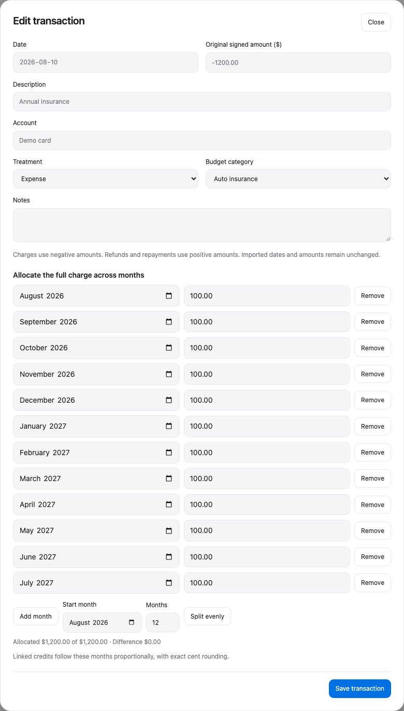
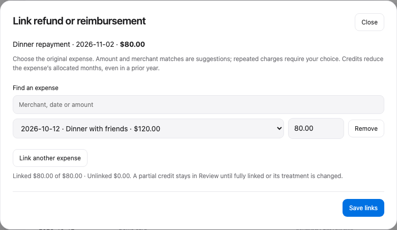

# Budget Dashboard

I didn’t want to pay another subscription to track my subscriptions.

So I built a local dashboard that counts expenses the way I want: annual costs spread across the months they cover, and refunds and reimbursements linked back to the purchases they offset. It runs on your Mac, stores your records in CSV, and has no subscription or runtime cloud service.


*The October demo includes an annual insurance allocation and a dinner reimbursement received in November.*

## What it does

- **Spread costs across months.** Allocate a $1,200 annual charge as $100 per month, or enter a different distribution. The original transaction date and amount stay intact.
- **Apply credits to the right expenses.** Link a refund or reimbursement to one or several purchases. Partial credits reduce the original allocation months proportionally, including prior months and years, with exact cent rounding.
- **Import and reconcile.** Import Empower CSVs, preview overlaps, and reconcile manual entries without losing their allocations or notes. Other bank exports can be converted locally by your coding agent.
- **Review spending.** Search and sort transactions, detect fixed monthly subscriptions, edit monthly budgets, compare trends, and hide months without deleting records.
- **Keep your records.** Original exports, transaction edits, and linked credits stay available. Saves are atomic and keep the latest 30 backups.



*A later $240 refund reduces each $100 allocation to $80.*



*The repayment reduces October’s dinner cost to $40, although the money arrived in November.*

## Set it up with your agent

Give Codex or Claude Code this repository and say:

> Read AGENTS.md and set up Budget Dashboard for me on macOS. Ask for my categories, starting budgets, and CSV format, then verify it works.

The agent follows [the setup procedure](docs/setup.md), configures your local files, and checks the app. Empower exports work directly; other banks get a reusable local conversion command. Your agent can help configure the app, but you do not need an AI session to use it each month.

## Try the demo yourself

Requires **Python 3.9+** on macOS. The app uses only Python’s standard library and your browser.

```sh
git clone https://github.com/AdhirajGoel/budget-dashboard.git
cd budget-dashboard
python3 demo.py
python3 budget_server.py --data-dir demo-data
```

The browser opens automatically. Select **October 2026** to see the examples above. Demo creation refuses to overwrite an existing directory. Stop the server with **Control-C**.

For your own records, copy `config.example.json` to `data/config.json`, configure it before importing, and launch:

```sh
mkdir -p data
cp -n config.example.json data/config.json
python3 budget_server.py
```

You can also double-click **Open Budget.command** after setup. See [setup](docs/setup.md) for configuration and [using the dashboard](docs/usage.md) for imports, allocations, credits, and recovery.

## Development

Python serves a plain JavaScript/CSS interface on `127.0.0.1`. Amounts are stored as integer cents in memory and decimal dollars in CSV. No frontend build or runtime packages are required. Node is used only for interface regression tests; Playwright is optional for browser checks and screenshots.

```sh
python3 -m unittest -v test_budget.py test_release.py
node test_app.js
# With Playwright and its Chromium browser installed:
python3 test_browser.py
python3 capture_demo.py
```

Tests and screenshots use synthetic data in temporary directories. [Development notes](docs/development.md) describe the calculation model and checks.

MIT licensed. See [LICENSE](LICENSE).
