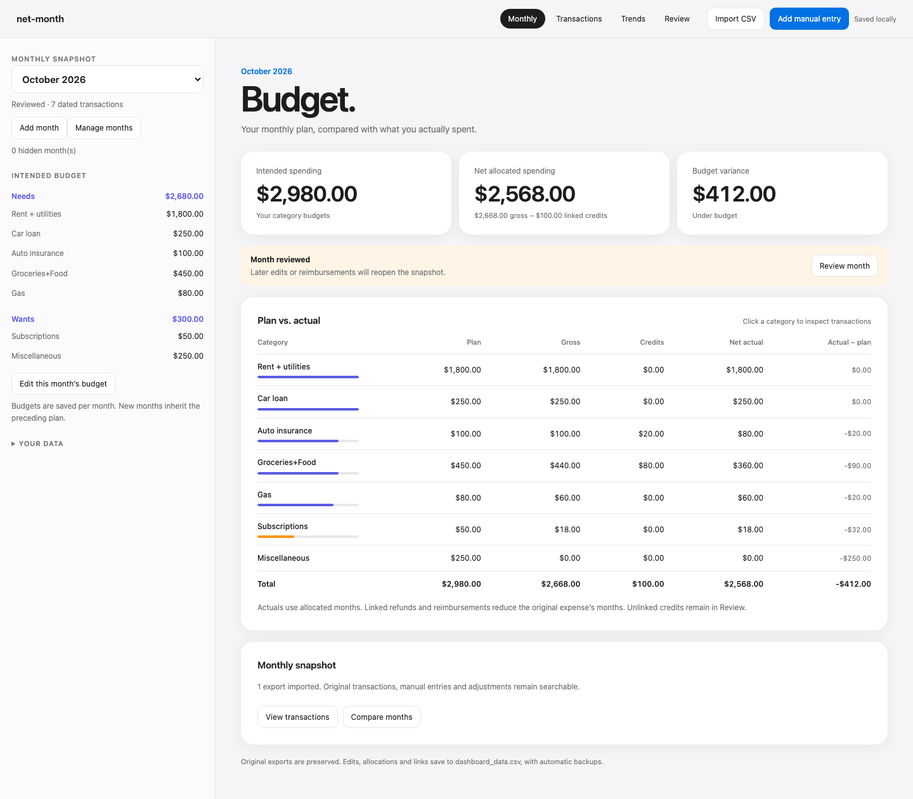

# net-month

I didn’t want to pay another subscription to track my subscriptions.

So I built a local dashboard that counts expenses the way I want: annual costs spread across the months they cover, and refunds and reimbursements linked back to the purchases they offset. It runs on your Mac, stores your records in CSV, and has no subscription or runtime cloud service.

Import Empower CSVs, review recurring subscriptions, and compare monthly spending with your budgets. Other bank exports can be converted locally during setup.



*Synthetic records for October 2026. An $80 repayment received in November reduces October’s $120 dinner cost to $40.*

## Try the demo

Requires Python 3.9+ on macOS. The app uses only Python’s standard library and your browser.

```sh
git clone https://github.com/AdhirajGoel/net-month.git
cd net-month
python3 demo.py
python3 budget_server.py --data-dir demo-data
```

The browser opens automatically. Select **October 2026** for the view above. Demo creation refuses to overwrite an existing directory. Stop the server with **Control-C**.

## Set it up with your agent

Give Codex or Claude Code this repository and say:

> Read AGENTS.md and set up net-month for me on macOS. Ask for my categories, starting budgets, and CSV format, then verify it works.

The agent follows [the setup procedure](docs/setup.md) to configure your categories, prepare imports, and check the app. After setup, double-click **Open net-month.command** to use it without an AI session.

See [Using net-month](docs/usage.md) for allocations, linked credits, and recovery, or [development and release status](docs/development.md) for the calculation model and tests.

MIT licensed. See [LICENSE](LICENSE).
